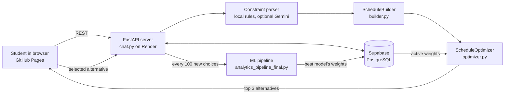

# AI-Powered Personal Academic Advisor

A chat-based assistant that builds a student's semester timetable from plain-language requests (in Hebrew), offers up to three ranked alternatives, and learns from the alternative each student picks.

**Live demo:** https://rotemb111.github.io/Final-Project---AI-Powered-Personal-Academic-Advisor/

| | |
|---|---|
| Demo login | `noa.cohen0001` / `demo1234` (or register a new student) |
| Analytics page | [analytics.html](https://rotemb111.github.io/Final-Project---AI-Powered-Personal-Academic-Advisor/analytics.html) |
| API | https://course-scheduler-api-jnh5.onrender.com/api/health |

> The server runs on Render's free tier and sleeps when idle, so the first request can take up to a minute.

Final project for a B.Sc. in Industrial Engineering and Management. The interface is in Hebrew.

---

## What it does

1. **The student describes what they want** – e.g. *"תבנה לי מערכת בלי ימי שני, לא לפני 10:00, עם כמה שפחות חלונות"* ("build me a schedule without Mondays, not before 10:00, with as few gaps as possible").
2. **The constraints are extracted** from the message and stored for the conversation, so follow-up messages add to or replace them.
3. **A builder searches every legal combination** of course groups (lecture + tutorial) for the student's mandatory courses that satisfies the hard constraints. If a full schedule is impossible, it falls back to the best partial schedule and explains which courses were left out.
4. **An optimizer ranks the candidates** using seven weighted penalty criteria and returns the top three, with an explanation of which requests were met.
5. **The student picks one alternative.** The choice is saved as a label, and after every 100 new choices the ML pipeline retrains and updates the ranking weights.

Students can also keep a chat history, pin and delete conversations, and edit their profile.

### Supported constraints

Day off · time window (start after / end before) · fewer gaps between classes · maximum study days · daily load · maximum consecutive hours · avoid or prefer a lecturer · add or remove a course · course-specific day/time preference · allowing a course to be dropped to get a better schedule.

---

## Architecture



**Constraint parsing.** Common requests (days, hours, gaps, lecturers, number of days, course changes) are parsed locally with rules, so the demo runs without any LLM calls. Gemini can be switched on (`USE_GEMINI=true`) to handle free-form messages the rules don't recognise.

**Builder.** Depth-first search over course groups with conflict detection, applying hard constraints at the meeting level (days, time windows, lecturers) and at the schedule level (study days, daily load, consecutive hours). It falls back to backup courses and then to partial schedules when no full schedule exists.

**Optimizer.** Each candidate gets a penalty from 0 to 1 per criterion, combined into a weighted score:

| Key | Criterion |
|---|---|
| G | Gaps between classes |
| D | Number of study days |
| LD | Daily load |
| T | Fit to preferred hours |
| LW | Weekly balance |
| C | Assessment load (exams / projects) |
| A | Mandatory attendance |

The weights start from fixed defaults and are replaced by the weights learned from student choices.

---

## Learning from student choices

Every alternative shown is stored with its seven penalty scores. When a student selects one, it's labeled as chosen and the others in that session as rejected.

Once 100 new labeled sessions have accumulated, the server retrains in the background (`analytics_pipeline_final.py`):

- Trains **Logistic Regression**, **Random Forest** (grid search) and **XGBoost**, plus a semi-supervised pseudo-labeling pass over unlabeled sessions.
- Picks the best model by AUC (then F1, recall, precision).
- Converts its coefficients or feature importances into criterion weights and marks that run as active.
- The chat starts ranking with the new weights within a few minutes. No redeploy is needed.

The [analytics page](https://rotemb111.github.io/Final-Project---AI-Powered-Personal-Academic-Advisor/analytics.html) shows the active model, learned vs. default weights, which alternative students pick, the constraints they ask for, and the full training history.

### About the demo data

The demo database is seeded with **simulated** usage, not real students. `simulate_sessions.py` ran 400 conversations through the real chat logic, with synthetic student personas that each have hidden preferences and choose between the alternatives. `upload_simulation.py` loaded those sessions into Supabase. The TabPFN run shown as active comes from an offline experiment; the deployed server retrains with the three models listed above. The numbers on the analytics page show how the learning loop works and aren't findings about real students.

---

## Tech stack

- **Backend:** Python 3.11, FastAPI, Uvicorn
- **Database:** Supabase (PostgreSQL), accessed only from the server
- **ML:** scikit-learn, XGBoost, pandas, NumPy
- **Frontend:** HTML, CSS and vanilla JavaScript, with Chart.js for the analytics page
- **Hosting:** GitHub Pages (site), Render free web service (API), plus a GitHub Actions keep-alive ping

---

## Repository structure

| File | Purpose |
|---|---|
| `chat.py` | FastAPI app: chat endpoint, constraint parsing, auth, history, schedule selection, analytics API, background retraining |
| `builder.py` | `ScheduleBuilder` – generates every valid timetable under the hard constraints |
| `optimizer.py` | `ScheduleOptimizer` – scores and ranks timetables by the seven criteria |
| `analytics_pipeline_final.py` | ML training pipeline; can also be run from the command line |
| `simulate_sessions.py`, `upload_simulation.py` | Generate the simulated demo sessions and load them into Supabase (with rollback) |
| `build_checkpoint_report_doc.py`, `build_analytics_summary_doc.py` | Generate the Hebrew Word reports of the training runs |
| `index.html`, `login.html`, `register.html`, `dashboard.html`, `profile.html`, `analytics.html`, `about.html` | Frontend pages |
| `config.js` | Chooses the API address: localhost when run locally, Render when served from GitHub Pages |
| `render.yaml` | Render blueprint for the API service |
| `supabase_security.sql` | Enables row-level security, so tables are reachable only through the server |
| `DEPLOY.md` | Step-by-step free deployment guide (Hebrew) |
| `SCHEDULING_ENGINE_CHANGES.md`, `CHANGELOG.md` | Engineering notes on the scheduling engine |

---

## Running locally

```bash
pip install -r requirements.txt
```

Create a `.env` file:

```
SUPABASE_URL=https://<project>.supabase.co
SUPABASE_KEY=<server-side secret key>
# optional
USE_GEMINI=false
GEMINI_API_KEY=
```

Start the server and open the site:

```bash
python -m uvicorn chat:app --reload --port 8000
```

Then open `index.html` in a browser. `config.js` points the pages at `http://localhost:8000` automatically.

Retrain the model manually. This trains on the database and saves a new run, which can become the active model:

```bash
python analytics_pipeline_final.py
```

To see the models trained at every 100 choices without writing anything to the database:

```bash
python analytics_pipeline_final.py --checkpoints
```

---

## Team

אופק נתנאל · אור כהן · רותם ברק · מידן מינצס
